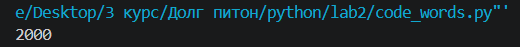

# Лабораторная работа №2 — Комбинаторика и itertools

## 📌 Условие задачи

Иван составляет таблицу кодовых слов для передачи сообщений, каждому сообщению соответствует своё кодовое слово. В качестве кодовых слов Иван использует все пятибуквенные слова в алфавите {A, B, C, D, E}, удовлетворяющие такому условию: кодовое слово не может начинаться с буквы E и заканчиваться буквой A.

**Вопрос:** Сколько различных кодовых слов может использовать Иван?

## 🔧 Описание проделанной работы

Для решения задачи использована функция product() из модуля itertools:

1. product('ABCDE', repeat=5) генерирует все возможные пятибуквенные слова из алфавита {A, B, C, D, E} — всего 5⁵ = 3125 комбинаций.
2. Каждое слово проверяется на два условия:
   - word[0] != 'E' — первая буква не E;
   - word[-1] != 'A' — последняя буква не A.
3. Подходящие слова подсчитываются счётчиком count.

**Математическая проверка результата:**
- первая буква — 4 варианта (A, B, C, D);
- три средние буквы — по 5 вариантов: 5³ = 125;
- последняя буква — 4 варианта (B, C, D, E);
- итого: 4 × 125 × 4 = **2000**.

**Ответ: 2000 кодовых слов.**

## 📸 Результат выполнения

## 🔗 Используемые материалы

- [Itertools в Python — Хабр](https://habr.com/ru/companies/otus/articles/529356/)
- [itertools — официальная документация Python](https://docs.python.org/3/library/itertools.html)
- [Итерируем правильно: 20 приёмов использования модуля itertools](https://proglib.io/p/iteriruemsya-pravilno-20-priemov-ispolzovaniya-v-python-modulya-itertools-2020-01-03)
