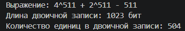
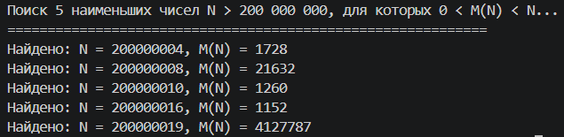

# Лабораторная работа №2 — Комбинаторика, itertools и теория чисел

## 📌 Условия задач

### Задача 1
Иван составляет таблицу кодовых слов для передачи сообщений, каждому сообщению соответствует своё кодовое слово. В качестве кодовых слов Иван использует все пятибуквенные слова в алфавите {A, B, C, D, E}, удовлетворяющие такому условию: кодовое слово не может начинаться с буквы E и заканчиваться буквой A. Сколько различных кодовых слов может использовать Иван?

### Задача 2
Сколько единиц содержится в двоичной записи значения выражения 4^511 + 2^511 − 511?

### Задача 3
Пусть M(N) — произведение 5 наименьших различных натуральных делителей натурального числа N, не считая единицы. Если у числа N меньше 5 таких делителей, то M(N) считается равным нулю.
Найдите 5 наименьших натуральных чисел, превышающих 200 000 000, для которых 0 < M(N) < N. В ответе запишите найденные значения M(N) в порядке возрастания соответствующих им чисел N.

## 🔧 Описание проделанной работы

### Задача 1 — Кодовые слова (itertools.product)
- product('ABCDE', repeat=5) генерирует все пятибуквенные слова алфавита {A, B, C, D, E}: всего 5^5 = 3125 комбинаций.
- Каждое слово проверяется на два условия: word[0] != 'E' (первая буква не E) и word[-1] != 'A' (последняя буква не A).
- Подходящие слова подсчитываются счётчиком.
- Математическая проверка: первая буква — 4 варианта (A–D), три средние — 5^3 = 125, последняя — 4 варианта (B–E): 4 × 125 × 4 = 2000.
- Ответ: 2000 кодовых слов.

### Задача 2 — Единицы в двоичной записи
- Значение выражения вычисляется напрямую: целые числа в Python имеют произвольную точность, переполнения не возникает.
- Количество единиц считается как bin(value).count('1'): bin() возвращает строку вида '0b101...', в которой подсчитываются символы '1'.
- Математическая проверка: 4^511 = 2^1022 — одна единица в позиции 1022; 2^511 − 511 = 2^511 − 512 + 1 = 2^9·(2^502 − 1) + 1 — это 502 единицы в позициях 9–510 плюс единица в позиции 0 (всего 503); биты не пересекаются, итого 1 + 503 = 504.
- Ответ: 504 единицы.

### Задача 3 — Делители и M(N)
- Функция divisors_gt1(n) собирает все делители числа, большие 1, перебором до корня из n (делители ходят парами d и n//d) и сортирует их.
- Функция m_of_n(n) перемножает 5 наименьших делителей; если делителей меньше 5, возвращает 0.
- Перебор кандидатов выполнен итератором itertools.count от 200 000 001 до нахождения пяти подходящих чисел.
- Анализ условия: 0 < M(N) требует минимум 5 делителей помимо 1 (простые числа и произведения двух простых отпадают, у них M = 0); условие M(N) < N требует маленьких наименьших делителей, поэтому подходят числа с мелкими делителями 2, 3, 5, 7 и т.д.
- Найденные числа и значения:
  - N = 200 000 004 = 2²·3·16 666 667, делители 2, 3, 4, 6, 12 → M = 1728
  - N = 200 000 008 = 2³·13·1 923 077, делители 2, 4, 8, 13, 26 → M = 21632
  - N = 200 000 010 = 2·3·5·7·952 381, делители 2, 3, 5, 6, 7 → M = 1260
  - N = 200 000 016 = 2⁴·3·4 166 667, делители 2, 3, 4, 6, 8 → M = 1152
  - N = 200 000 019 = 3·17·23·170 503, делители 3, 17, 23, 51, 69 → M = 4127787
- Ответ: 1728, 21632, 1260, 1152, 4127787.

## 📸 Результаты выполнения

### Задача 1 — Кодовые слова

### Задача 2 — Двоичная запись

### Задача 3 — Значения M(N)

## 🔗 Используемые материалы

- [Itertools в Python — Хабр](https://habr.com/ru/companies/otus/articles/529356/)
- [itertools — официальная документация Python](https://docs.python.org/3/library/itertools.html)
- [Итерируем правильно: 20 приёмов использования модуля itertools](https://proglib.io/p/iteriruemsya-pravilno-20-priemov-ispolzovaniya-v-python-modulya-itertools-2020-01-03)
- [bin() — официальная документация Python](https://docs.python.org/3/library/functions.html#bin)